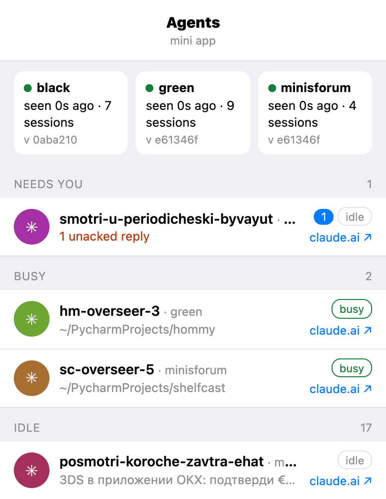
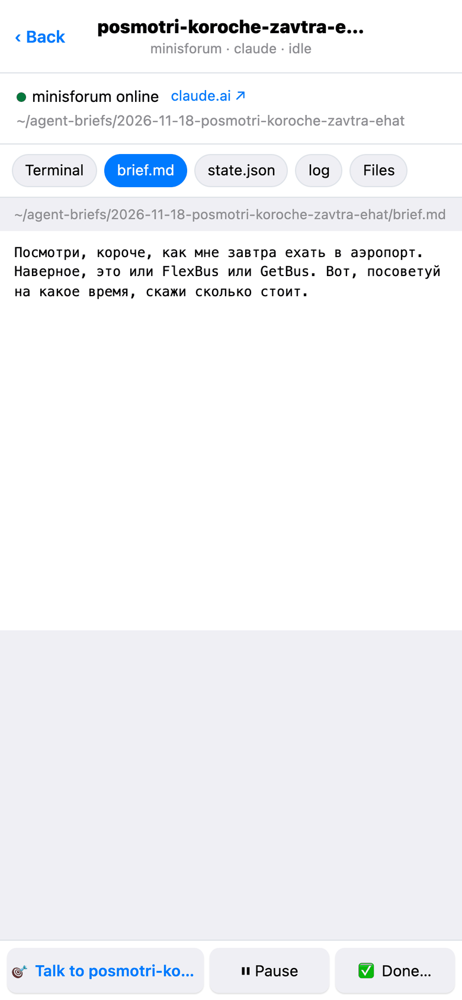
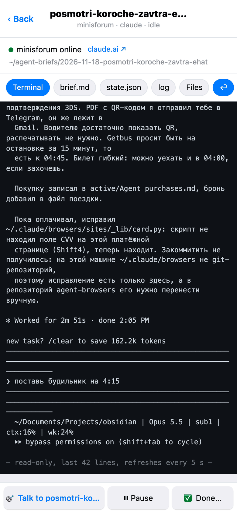

# hommy

Send a Telegram voice note. A Claude Code session on your Mac does the errand and answers in the same chat.

<table>
<tr>
<td width="33%" valign="top"><br><sub>Every agent session on your Macs: who needs you, who is busy.</sub></td>
<td width="33%" valign="top"><br><sub>A voice note becomes the session's brief: <i>“How do I get to the airport tomorrow? FlexBus or GetBus: when, and how much?”</i></sub></td>
<td width="33%" valign="top"><br><sub>The result: ticket bought, QR code sent to Telegram, purchase logged in the vault.</sub></td>
</tr>
</table>

<sub>Screens from the optional Telegram Mini App ([docs/configuration.md](docs/configuration.md#mini-app-opt-in)).</sub>

- **Runs on your Mac.** A hub talks to Telegram, a host opens sessions in [agterm](https://github.com/umputun/agterm),
  speech stays local (whisper, Kokoro). More Macs can join.
- **Your own Claude.** hommy starts the unmodified `claude` you are signed in to; it is never bundled.
- **A markdown vault** is its memory and its recipe book.
- **Asks before it commits.** Bookings, payments and messages wait for your Yes in Telegram.
- macOS 14+ on Apple Silicon.

## Install

```sh
curl -fsSL https://raw.githubusercontent.com/AlexDobrushskiy/hommy/main/install.sh | bash
```

It installs what is missing, asks for your bot token (from [@BotFather](https://t.me/BotFather)) and pairs your
Telegram account. Safe to re-run; upgrades keep your settings. Flags and the full list of what gets installed:
[docs/install.md](docs/install.md).

## First steps

1. **Pair:** open the `t.me` link setup prints.
2. **Talk:** send the bot a voice note: "What's in my vault?"
3. **Check:** `hommy doctor`
4. **Teach it about you:** tell it "Run the retainer interview".

Watch a whole errand without booking anything real: [the barber demo](docs/usage.md#the-barber-demo).

## Docs

| | |
|---|---|
| [docs/install.md](docs/install.md) | installer flags, what gets installed, setup step by step, pairing, unattended install, uninstall |
| [docs/usage.md](docs/usage.md) | what you can send, chat commands, voices, the barber demo |
| [docs/configuration.md](docs/configuration.md) | config keys, services and logs, doctor, signing, more Macs, the Mini App |
| [docs/plugin-and-vault.md](docs/plugin-and-vault.md) | the Claude Code plugin (hooks, skills) and the vault template |
| [docs/testing.md](docs/testing.md) | development and the end-to-end tests |

## Risks

- **Skipped permissions** (default): agents run commands without asking, and only you, the paired owner, can reach
  them. `hommy config permissions ask` turns prompts back on.
- **WhatsApp and your own Telegram account** are opt-in extras; automating them carries an account risk (WhatsApp's
  terms).
- **No Apple Developer ID:** a self-signed certificate keeps macOS privacy grants stable across upgrades; it proves
  nothing about who built the binary.
- **Anthropic:** hommy runs the unmodified `claude` on your own subscription and never wraps it in an Agent SDK harness.

## License

MIT, see [LICENSE](LICENSE). [hommy-browsers](https://github.com/AlexDobrushskiy/hommy-browsers) is MIT too; every
installed tool keeps its own license.
